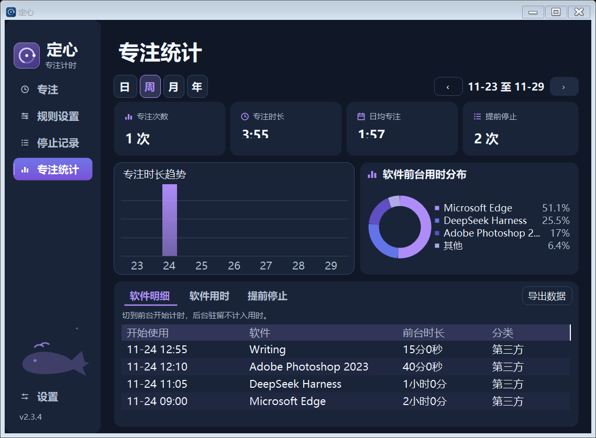
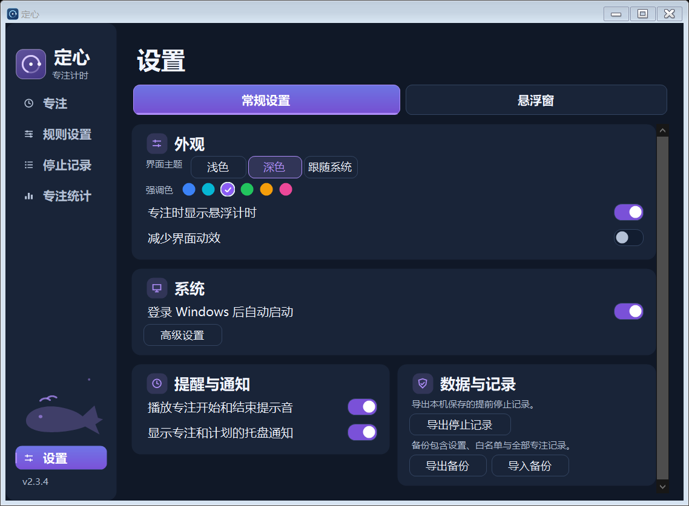

# 定心 · 专注守门

一个 Windows 桌面专注工具：开始专注后只允许白名单里的软件和网站，其余前台窗口会被收起；网站通过本地代理拦截，不修改系统 DNS，也不注入浏览器。

- 单文件安装包，内置卸载程序与应急停止工具
- 数据全部保存在本机，使用 Windows DPAPI 加密
- 无第三方依赖，只用 .NET Framework 4.8 自带类库

## 功能

- **专注计时**：倒计时 / 正计时，自动开始计划，暂停额度，提前停止记录
- **软件白名单**：按软件组放行，支持已识别软件选择与手动添加
- **网站白名单**：本地 HTTP/HTTPS 代理拦截，支持精确域名与 `*.子域名`
- **开始前检查**：开始前查看本轮限制，网页自检（DNS / 443 / 拦截是否生效）
- **悬浮计时窗**：置顶/锁定可切换，颜色可跟随主题或单独设置
- **专注统计**：按日/周/月/年统计，前台软件用时分布，数据导出
- **主题**：深色 / 浅色 / 跟随系统，强调色 6 套预设，悬浮窗独立配色
- **安装/卸载**：自定义安装路径，桌面与开始菜单快捷方式，两级卸载确认，可选删除个人数据

## 截图

| 专注 | 规则 |
| --- | --- |
|  |  |

| 统计 | 设置 |
| --- | --- |
|  |  |

## 下载与安装

1. 在 [Releases](../../releases) 下载最新的 `定心_x.y.z_Setup.exe`；
2. 运行后选择安装目录；
3. 安装完成会创建桌面与开始菜单快捷方式，目录内包含：
   - `定心.exe` 主程序
   - `卸载.exe` 卸载程序
   - `应急停止.exe` 应急清理工具
   - `源代码\` 对应版本的源码

系统要求：Windows 10 / 11，.NET Framework 4.8（系统自带）。

## 从源码构建

需要 Windows 自带的 .NET Framework 编译器（无需 Visual Studio / .NET SDK）：

```powershell
cd src\app
powershell -NoProfile -ExecutionPolicy Bypass -File .\Build.ps1 -OutputDirectory .\out
```

产物：`out\StudyFocus_Setup.exe`。

构建前如需内置应急停止工具，先构建它：

```powershell
cd src\emergency
powershell -NoProfile -ExecutionPolicy Bypass -File .\Build-Emergency.ps1 -SourceDir ..\app
```

`Build.ps1` 会自动把 `..\emergency\StudyFocus_EmergencyStop.exe` 和 `Sources.zip` 嵌入安装包。

## 目录结构

```text
src/
  app/            主程序源码（WinForms）
  emergency/      应急停止工具源码
docs/screenshots/ 界面截图
publish.ps1       一键初始化 git 并推送到 GitHub 的脚本
```

## 数据与隐私

- 设置与记录：`%LOCALAPPDATA%\StudyFocus`（`state.dat` 经 DPAPI 加密）
- 崩溃日志：同目录 `crash-*.log`，最多保留 20 个
- 网站访问只经过本机 `127.0.0.1` 代理，不上传任何数据

## 已知限制

- 未做 Authenticode 签名，首次运行会有 SmartScreen 提示
- 网站拦截基于域名，页面样式/视频依赖同站 CDN；已为 B 站内置关联域名，其它站点可在白名单中自行添加 CDN 域名
- 未启用 PerMonitorV2，多显示器不同缩放拖动时可能需要重开窗口

## License

MIT，见 [LICENSE](LICENSE)。
