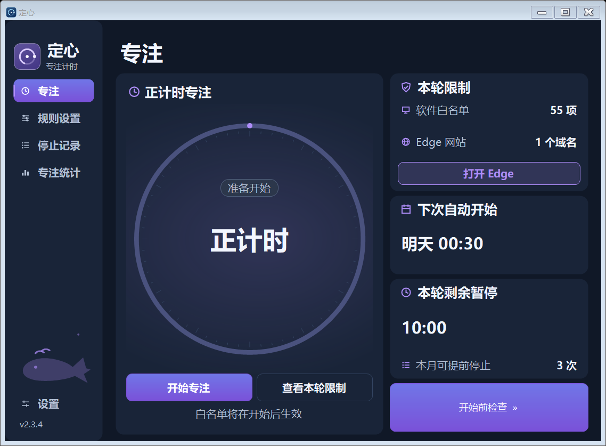
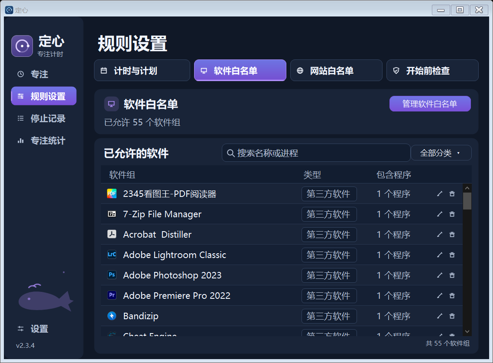

# 定心 · 专注守门

一个 Windows 桌面专注工具：开始专注后只允许白名单里的软件和网站，其余前台窗口会被收起；网站通过本地代理拦截，不修改系统 DNS，也不注入浏览器。

- 单文件安装包，内置卸载程序与应急停止工具
- 数据全部保存在本机，使用 Windows DPAPI 加密
- 无第三方依赖，只用 .NET Framework 4.8 自带类库

## 功能

- **专注计时**：倒计时 / 正计时，自动开始计划，暂停额度，提前停止记录
- **自动开始计划**：时间段内启动即自动进入；停止后该计划自动变“已停用”；重新启用并保存时弹出 10 秒置顶倒计时，取消则恢复停用
- **软件白名单**：按软件组放行，支持已识别软件选择与手动添加
- **进程放行**：允许白名单软件的安装目录子进程与插件进程（如微信小程序、网盘内嵌浏览器），最多追溯 4 层父进程
- **网站白名单**：本地 HTTP/HTTPS 代理拦截，支持精确域名与 `*.子域名`
- **日常 Edge 配置**：可用已登录的 Edge 打开专注浏览器，保留账号、密码、收藏
- **开始前检查**：开始前查看本轮限制，网页自检（DNS / 443 / 拦截是否生效）
- **悬浮计时窗**：置顶/锁定可切换，颜色可跟随主题或单独设置
- **专注统计**：按日/周/月/年统计，前台软件用时分布，数据导出
- **主题**：深色 / 浅色 / 跟随系统，强调色 6 套预设，悬浮窗独立配色
- **安装/卸载**：自定义安装路径，桌面与开始菜单快捷方式，两级卸载确认，可选删除个人数据

## 截图

<p align="center">
  
  
  <br>
  <sub>专注 / 规则设置</sub>
</p>

<p align="center">
  
  
  <br>
  <sub>专注统计 / 设置</sub>
</p>

## 下载与安装

1. 在 [Releases](../../releases) 下载最新的 `dingxin-x.y.z-Setup.exe`；
2. 运行后选择安装目录；
3. 安装完成会创建桌面与开始菜单快捷方式，目录内包含：
   - `定心.exe` 主程序
   - `卸载.exe` 卸载程序
   - `应急停止.exe` 应急清理工具
   - `源代码\` 对应版本的源码

系统要求：Windows 10 / 11，.NET Framework 4.8（系统自带）。

## 使用说明

- 网站限制只对“专注 Edge”生效；点“打开专注 Edge”会用本地代理参数启动浏览器；
- 设置中可开启“专注 Edge 使用日常配置”，用你已登录的配置打开，账号、密码、收藏保留；
- 使用日常配置前需完全退出 Edge（含后台常驻），否则本轮自动退回独立配置；
- 应急停止：专注中运行安装目录的 `应急停止.exe`，会清会话、写“强制停止（应急）”记录。

## 从源码构建

需要 Windows 自带的 .NET Framework 编译器（无需 Visual Studio / .NET SDK）。

**先构建应急停止工具**（它的版本门禁跟随主程序版本）：

```powershell
cd src\emergency
powershell -NoProfile -ExecutionPolicy Bypass -File .\Build-Emergency.ps1 -SourceDir ..\app
